# Minimal cinematic portfolio

A cinematic, single-page portfolio template for developers, built with **Next.js** and **TypeScript**, exported as a static site and deployed to **GitHub Pages** on every push to `main`.

### [→ Live demo](https://antoniooodev.github.io/minimal-cinematic-portfolio/)

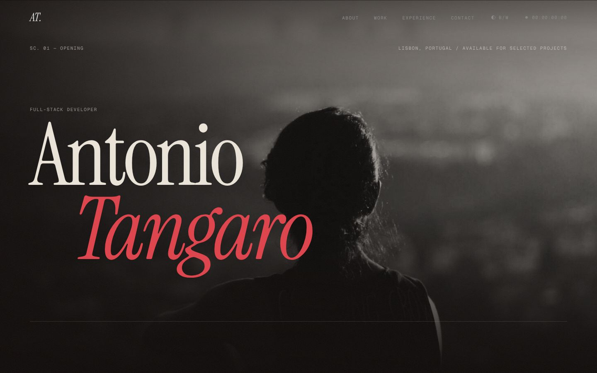

The page is staged like a short film: it opens on a "Designed by" title card, moves through numbered scenes that alternate dark and light, and closes on end credits. A timecode in the header follows the scroll from `00:00:00:00` to `00:03:00:00`.

## Contents

- [Screenshots](#screenshots)
- [Features](#features)
- [Getting started](#getting-started)
- [Make it yours](#make-it-yours)
- [Publish on GitHub Pages](#publish-on-github-pages)
- [Directory structure](#directory-structure)
- [Scripts](#scripts)
- [Credits](#credits)
- [License](#license)

## Screenshots

<table>
  <tr>
    <td>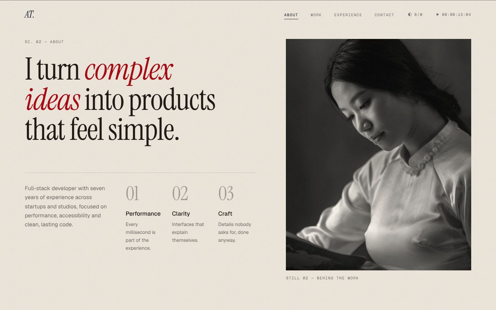</td>
    <td>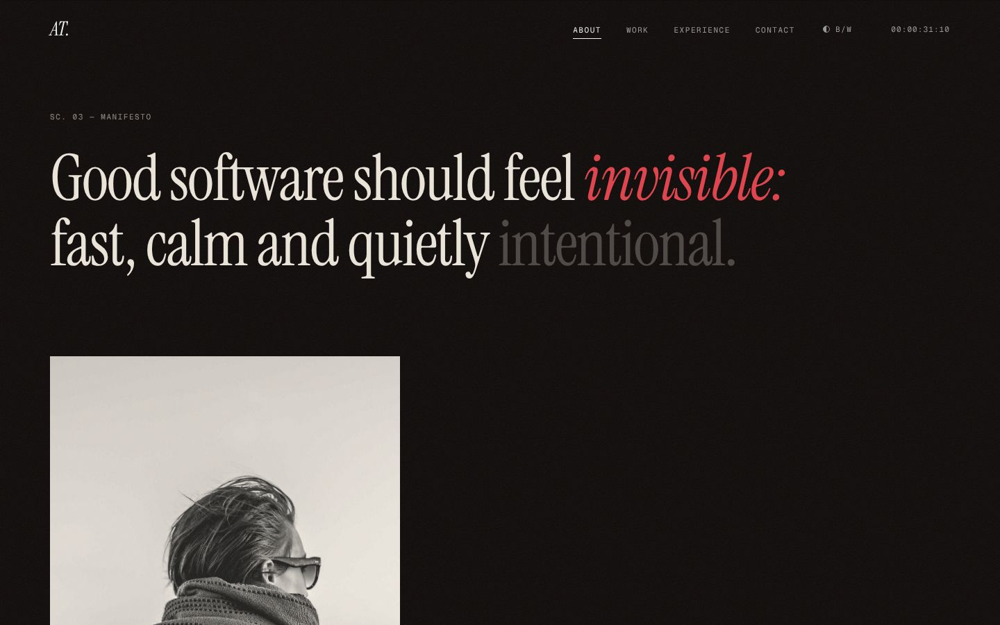</td>
  </tr>
  <tr>
    <td>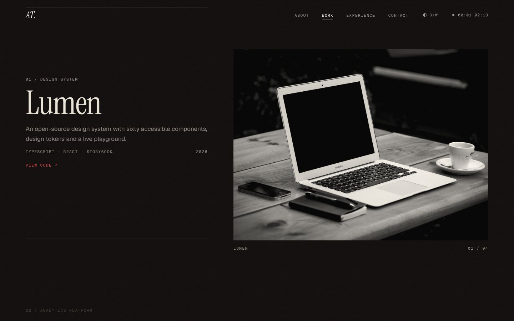</td>
    <td>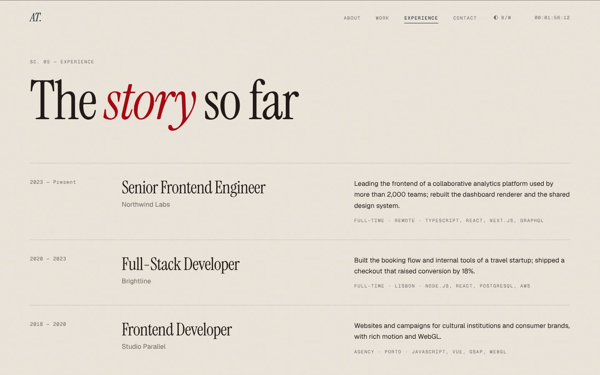</td>
  </tr>
  <tr>
    <td>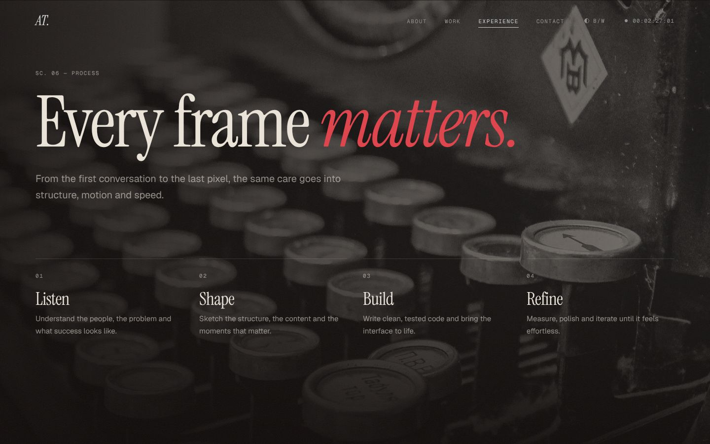</td>
    <td>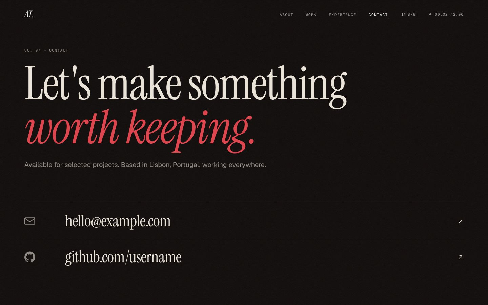</td>
  </tr>
  <tr>
    <td colspan="2">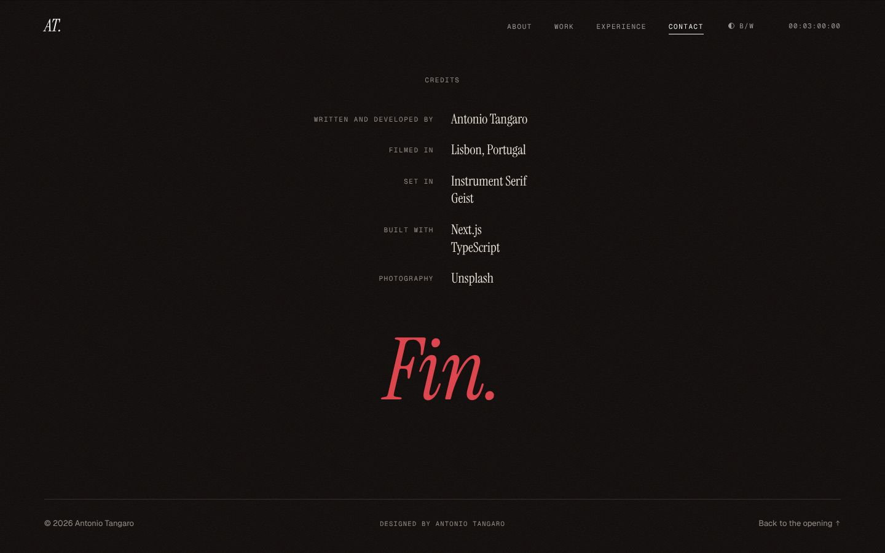</td>
  </tr>
</table>

**Black and white version**, switched from the header:

<table>
  <tr>
    <td>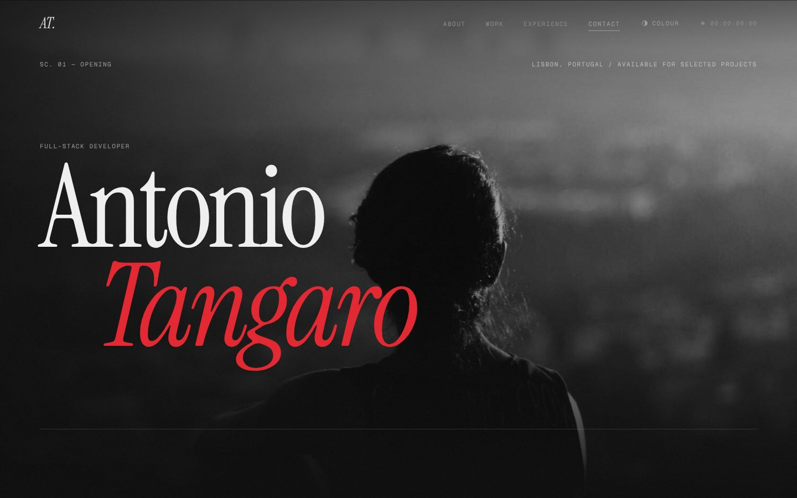</td>
    <td>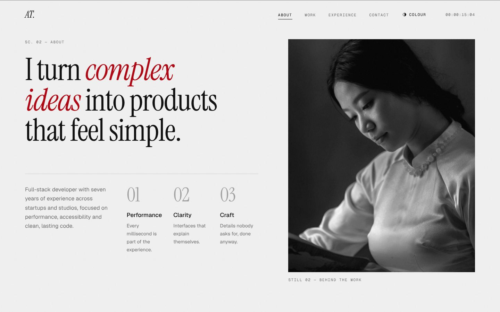</td>
  </tr>
  <tr>
    <td colspan="2">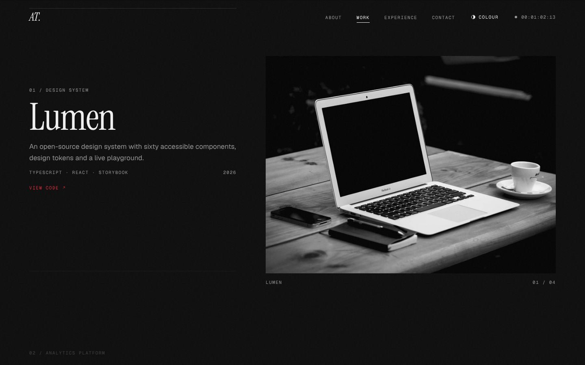</td>
  </tr>
</table>

**On phones:**

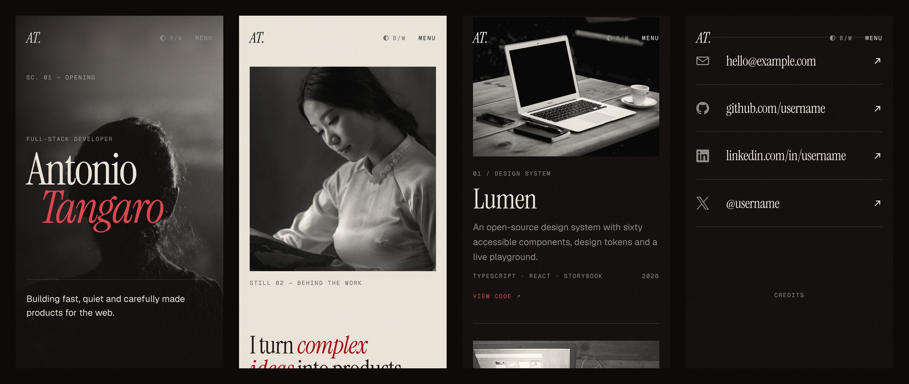

## Features

**Scenes**

| # | Scene | Content |
|---|---|---|
| 01 | Opening | Full-screen photo with a slow push-in, the name set large, the role, a one-line pitch and the local time. |
| 02 | About | A statement, a short bio, three principles and a portrait that opens like a curtain. |
| 03 | Manifesto | A large statement whose words light up as you scroll, with a photo and two paragraphs. |
| — | Skills | A band with the logos of the stack scrolling by. |
| 04 | Work | Featured projects scroll on the left while a sticky frame shows the current one; the other projects follow in an archive list. |
| 05 | Experience | Roles, then education and certifications. |
| 06 | Process | Four working steps over a full-bleed photo. |
| 07 | Contact | Email and social links with their logos, end credits, copyright and design credit. |

**Two versions**

- **Colour** (default): deep crimson `#A7010D` with cocoa brown `#6E4B3A` as its warm counterpart, on warm black `#0E0A09` and ivory `#ECE5DA`.
- **Black and white**: pure black and white, with crimson kept for a few accents. Photos lose their warm tint.

The visitor's choice is remembered on the next visit.

**Motion**

- A letterbox title card that parts to open the page.
- Film grain over the whole picture.
- Titles that rise word by word and content that slides in as it enters the view, in both directions: from below when scrolling down, from above when scrolling up.
- Photos that open like a curtain and drift with a light parallax.
- A manifesto that lights up word by word with the scroll.
- A sticky project frame that cross-fades between projects.
- An endless band of technology logos.

**Built with**

- [Next.js](https://nextjs.org) (App Router) with `output: "export"`: plain HTML, CSS and JavaScript, ready for any static host.
- TypeScript in strict mode, with typed content.
- CSS Modules and CSS custom properties; no UI or animation library.
- [Instrument Serif](https://fonts.google.com/specimen/Instrument+Serif) and [Geist](https://vercel.com/font) Sans and Mono.
- Logos from [Simple Icons](https://simpleicons.org).

## Getting started

### 1. Requirements

- [Node.js](https://nodejs.org) 22 or newer (the version is pinned in `.nvmrc`)
- [Git](https://git-scm.com)

### 2. Get the code

Pick one:

- **Fork** the repository on GitHub (button in the top right), then clone your fork:

  ```bash
  git clone https://github.com/<your-username>/minimal-cinematic-portfolio.git
  ```

- **Clone** it directly:

  ```bash
  git clone https://github.com/antoniooodev/minimal-cinematic-portfolio.git
  ```

- **Download** it as a ZIP from **Code → Download ZIP** and unzip it.

### 3. Install and run

```bash
cd minimal-cinematic-portfolio
npm install
npm run dev
```

Open http://localhost:3000. The page reloads as you edit.

### 4. Build

```bash
npm run build
```

The static site is written to `out/`. Preview it with `npm run start`, or upload the folder to any static host (GitHub Pages, Netlify, Vercel, Cloudflare Pages…).

## Make it yours

Everything you need to change is in two places: **`src/content/`** for the texts and **`public/images/`** for the photos.

1. **Profile**: in [`src/content/site.ts`](src/content/site.ts), edit `profile` with your name, role, location and time zone (an [IANA name](https://en.wikipedia.org/wiki/List_of_tz_database_time_zones) such as `Europe/Rome`), status, one-line pitch, email and social links. Each link can have an `icon` shown in the contact list.
2. **Texts of the scenes**: `about`, `principles`, `manifesto` and `process`. In titles, words wrapped in `*asterisks*` are set in the italic accent colour.
3. **Skills band**: `skills` lists the logos. Import any icon from Simple Icons by its `si` name and add it:

   ```ts
   import { siRust } from "simple-icons";

   export const skills: Skill[] = [
     { name: "Rust", icon: siRust },
     // …
   ];
   ```

   Icons missing from Simple Icons can be added to [`src/content/icons.ts`](src/content/icons.ts) as a 24×24 SVG path.
4. **Career**: `experience`, `education` and `certifications`, newest first. Leave `end` empty for something still ongoing.
5. **Projects**: `featured: true` puts a project in the showcase with its `image`; the others go in the archive list.
6. **Photos**: replace the files in [`public/images/`](public/images) (JPEGs about 1600–2400 px wide are enough) and update `photos` in `site.ts`. `position` keeps the subject in frame when a photo is cropped. Colour photos work too: the site shows them in black and white.
7. **Header links**: the sections linked in the header are listed in [`src/content/navigation.ts`](src/content/navigation.ts).
8. **Colours**: both palettes are defined as custom properties at the top of [`src/app/globals.css`](src/app/globals.css).

The content is typed in [`src/content/types.ts`](src/content/types.ts), so your editor flags a missing or misspelled field.

## Publish on GitHub Pages

The repository includes a workflow, [`.github/workflows/deploy.yml`](.github/workflows/deploy.yml), that lints, builds and publishes the site on every push to `main`.

1. Push the code to a GitHub repository.
2. Open **Settings → Pages** and set **Source** to **GitHub Actions** (only once).
3. Push to `main`, or run the workflow from the **Actions** tab.

The site goes live at `https://<your-username>.github.io/<repository>/`. Pull requests run the same lint and build without publishing.

If the site is served from a custom domain or from a `<your-username>.github.io` repository, set `PAGES_BASE_PATH` to an empty string in the workflow.

## Directory structure

```
minimal-cinematic-portfolio/
├── .github/workflows/
│   └── deploy.yml            # lint, build and publish to GitHub Pages
├── docs/screenshots/         # images used in this README
├── public/images/            # photos shown on the site (demo images)
├── src/
│   ├── app/
│   │   ├── layout.tsx        # fonts, metadata, header, opening title card
│   │   ├── page.tsx          # the single page, scene by scene
│   │   ├── not-found.tsx     # 404 page
│   │   ├── globals.css       # palettes, type, utilities and motion
│   │   └── icon.svg          # favicon
│   ├── components/
│   │   ├── effects/          # title card, scroll reveal, word-by-word titles,
│   │   │                     # scroll-lit text, parallax, marquee, timecode
│   │   ├── layout/           # header with menu and version switch, clock
│   │   ├── sections/         # one component per scene
│   │   └── ui/               # photo, logo, arrow, scene label
│   ├── content/
│   │   ├── site.ts           # all the texts, photos, projects and links
│   │   ├── types.ts          # content types
│   │   ├── icons.ts          # extra logos not in Simple Icons
│   │   └── navigation.ts     # sections linked in the header
│   └── lib/                  # formatting and version helpers
├── CREDITS.md                # authors of the demo photos
├── LICENSE
├── next.config.ts            # static export and GitHub Pages base path
└── package.json
```

## Scripts

| Script | Description |
|---|---|
| `npm run dev` | Start the development server |
| `npm run build` | Build the static site into `out/` |
| `npm run start` | Serve the `out/` folder locally |
| `npm run lint` | Run ESLint |
| `npm run typecheck` | Run the TypeScript compiler without emitting |

## Credits

- Design and development: [Antonio Tangaro](https://www.antoniotangaro.dev/).
- Demo photos: photographers on [Unsplash](https://unsplash.com), listed in [`CREDITS.md`](CREDITS.md). They are placeholders: replace them with your own before publishing.
- Logos: [Simple Icons](https://simpleicons.org) (CC0). The brands belong to their respective owners.
- Fonts: Instrument Serif and Geist, under the SIL Open Font License.

## License

The code is released under the [MIT License](LICENSE). You are free to use, change and publish it, including for commercial work, as long as the copyright notice stays in the source.

The demo photos are covered by the [Unsplash License](https://unsplash.com/license), not by the MIT License.

© 2026 Antonio Tangaro
